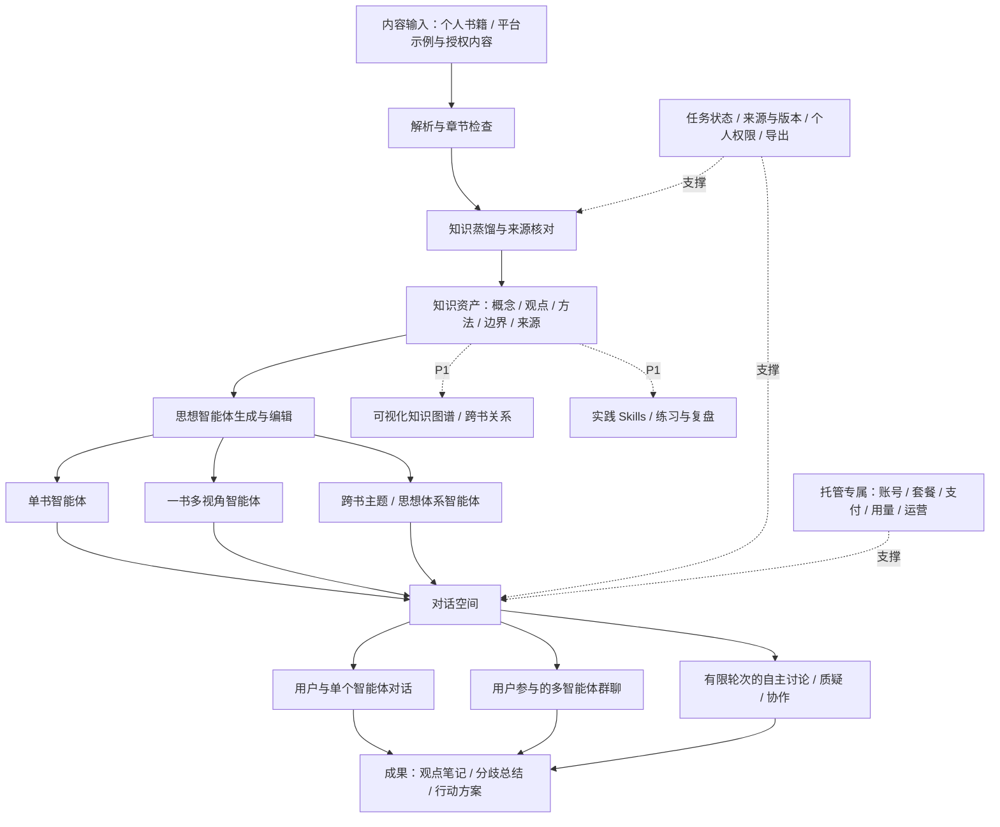
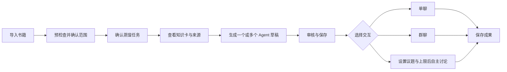

# 产品需求说明书：非虚构知识蒸馏与多智能体对话平台

> **版本：** v1.0  
> **日期：** 2026-10-29  
> **文档用途：** 作为 Codex 开发前后端、实现业务流程和逐项验收的功能依据。  
> **产品名称：** 暂未确定；本文使用“本产品”，不预设最终品牌名称。  
> **产品形态：** 面向个人的开源产品，支持本地部署；同时提供注册后付费使用的官方托管服务。  
> **范围：** 只规定产品功能、页面、交互、业务规则、状态和验收要求；不指定技术栈、数据库、接口协议、部署架构或模型厂商。

**快速导航**

| 阅读目的 | 对应章节 |
|---|---|
| 了解产品和首版范围 | [产品定位](#01-产品定位目标与边界) · [发布阶段](#02-发布范围与阶段) · [架构图](#04-功能架构图) |
| 开发页面和核心功能 | [页面清单](#06-页面与导航) · [内容管理](#08-书籍与内容管理) · [知识蒸馏](#09-内容蒸馏与知识资产) · [Agent 创建](#11-思想智能体的创建与管理) |
| 开发聊天和自主讨论 | [单聊](#12-用户与单个-agent-对话) · [群聊与思想圆桌](#13-多-agent-群聊与思想圆桌) · [成果导出](#14-成果个人笔记与导出) |
| 开发本地与托管服务 | [模型设置](#16-模型选择与本地部署体验) · [账号](#17-托管账号登录与权益状态) · [隐私与删除](#18-隐私内容权限与数据生命周期) · [套餐与支付](#19-托管套餐支付与用量) |
| 验收和发布 | [44 条验收用例](#22-功能验收清单) · [开发与发布顺序](#23-开发顺序与发布门槛) · [待确认事项](#24-默认决策与上线前待确认事项) |
| 直接开始开发 | [原创演示资料](#25-可直接使用的原创演示资料与体验脚本) · [Codex 执行说明](#26-可直接交给-codex-的执行说明) |

---

## 00. 文档使用约定

### 00.1 已确认的产品方向

1. 主要处理心理学、哲学、职场、成长、教育及其他工具性、启发性的非虚构内容，不以小说人物关系或娱乐角色扮演为重点。
2. 两项核心能力是：**蒸馏内容；把蒸馏结果转化为一个或多个可交流的思想智能体。**
3. 用户既能与智能体单聊、群聊，也能让智能体围绕议题相互回应、质疑和协作。
4. 智能体需要有独立的知识范围、思考框架、方法和适用边界，不能只是同一聊天助手换名称、头像。
5. 产品面向个人，而不是企业知识库。不开设部门、组织、企业审批等复杂功能。
6. 产品会开源，用户可在本地部署；运营方也会提供收费的托管服务。
7. 面向中文用户，核心功能不得强制依赖海外账号或只能在境外访问的服务。

### 00.2 本文新增设计的地位

本文对尚未明确的细节给出**可实施的默认方案**。例如默认讨论轮次、首次上线支持的格式和套餐续费规则，是本版产品建议，不代表此前已经逐项确认。

开发可按这些默认方案推进；将运营参数做成可配置项，不应因价格、品牌名称等未确定而阻塞核心功能开发。商业上线前需要确认的事项见第 24 节。

### 00.3 优先级与交付范围

| 标记 | 含义 | 交付要求 |
|---|---|---|
| P0-共用 | 本地版与托管版共用的核心功能 | 首版必须真实可用 |
| P0-本地 | 本地部署的必需功能 | 本地版首发必须完成 |
| P0-托管 | 注册、收费、用量和基本运营能力 | 托管版收费上线前必须完成 |
| P1 | 核心闭环后的增强功能 | 首版不得依赖其才能正常使用 |
| P2 | 公共社区、内容交易及其他扩展 | 不纳入首版验收 |

**本地版可在 P0-共用 + P0-本地完成后先发布；托管版必须另行完成 P0-托管，不能用“核心功能已完成”代替收费上线验收。**

### 00.4 对实现的基本要求

- 不能只实现静态页面、演示按钮或预设回答，然后声称功能已完成。
- 演示数据必须明确标注；未配置模型时，应显示配置指引，不得把演示回答冒充真实生成结果。
- 后续版本功能应隐藏或明确标注“暂未开放”，不展示可点击但没有业务结果的假入口。
- 本文中的“蒸馏”指知识提取、结构化、整理和重组，不要求训练或微调模型。
- 本文中的“Skills”首先指可复用的实践方法，不默认等于能够控制电脑或调用外部工具的自动化程序。

---

## 01. 产品定位、目标与边界

### 01.1 一句话定位

**把非虚构书籍变成可追溯的知识资产和可交流的思想智能体，让用户通过阅读、提问与多观点讨论，把知识用于真实问题。**

### 01.2 核心使用闭环

`导入内容 → 蒸馏并核对 → 生成思想智能体 → 单聊 / 群聊 / 自主讨论 → 保存观点与行动方案`

知识图谱、Skills、学习计划、公共分享服务于这条闭环，不应成为首版完成核心体验的前置条件。

### 01.3 目标用户与典型场景

| 用户 | 主要需求 | 产品应提供的结果 |
|---|---|---|
| 非虚构书籍读者 | 读完难以记住、难以迁移应用 | 可追溯的概念、方法和现实问题解答 |
| 自我成长学习者 | 对同一问题希望看到不同解释 | 不同思想智能体的讨论与分歧总结 |
| 内容创作者、研究爱好者 | 整理同一主题下的多本资料 | 跨书主题智能体、观点比较和笔记 |
| 产品经理、职场人士 | 将书中方法用于具体决策 | 条件明确、可执行、可复盘的建议 |
| 本地部署用户 | 自主选择模型、管理自己的资料 | 无强制云账号的完整个人使用闭环 |

### 01.4 核心成功标准

首版必须让一个新用户完成以下过程：导入两份可解析的非虚构资料，查看蒸馏结果，创建至少三个知识或立场有区别的智能体，发起一场有上限的讨论，并保存含来源和分歧的总结。

成功不以“回答很长”“智能体说得很多”为标准，而以以下可观察结果为准：

- 用户能说清楚各智能体分别依据什么资料、以什么框架分析。
- 用户能从重要观点回到对应的来源位置，或者明确看到“模型补充 / 用户补充 / 无来源”。
- 智能体能够回应前面发言，而不是各自独立生成互不关联的文章。
- 讨论能按设定停止，费用和用量不失控。
- 用户可以修正蒸馏结果，保留自己的笔记并导出资产。

### 01.5 首版不做

| 不做的内容 | 原因或边界 |
|---|---|
| 企业组织、部门权限、审批流 | 与个人定位不符 |
| 小说人物关系、世界观和剧情追踪 | 不是目标内容类型 |
| 强娱乐化角色扮演、恋爱陪伴 | 不作为核心产品定位 |
| 公共书籍交易、作者分成、用户间 Agent 交易 | 先验证个人闭环，P2 再评估 |
| 默认联网搜索和自动执行外部操作 | 首版优先保证来源可控与讨论可追溯 |
| 心理诊断、医疗治疗、投资决策等专业替代服务 | 本产品定位为学习、思考与方法实践工具 |
| 无上限的智能体自主运行 | 必须受轮次、发言数和用量上限约束 |
| 模型训练、微调平台 | 不属于本次功能需求 |
| 实时语音、视频、移动端原生 App | 先完成网页核心体验 |

---

## 02. 发布范围与阶段

| 阶段 | 包含功能 | 可对外状态 |
|---|---|---|
| M1：本地核心闭环 | 书籍导入、可溯源蒸馏、知识卡、Agent 创建、单聊、群聊、自主讨论、总结、导出、自有模型配置 | 可发布开源个人版本 |
| M2：托管收费闭环 | 账号隔离、套餐、支付、用量、任务额度预留、订单、运营管理、投诉入口 | 完成验收后可收费 |
| M3：知识应用增强 | 可视化图谱、跨书关系审核、实践 Skills、练习复盘、迁移导入、托管自带模型 | 增量上线 |
| M4：分享与生态 | 经审核的公开知识与 Agent、分享访问控制、社区和市场 | 另行立项，不自动纳入本版 |

M1 与 M2 的差异是服务运营，不是剥离本地版的知识和对话能力。不得把本地版核心功能做成必须登录官方云服务才能解锁。

---

## 03. 运行模式、角色与权限

### 03.1 两种运行模式

| 事项 | 本地部署模式 | 官方托管模式 |
|---|---|---|
| 进入产品 | 默认单人使用，无强制注册 | 可查看介绍与演示；个人使用需注册登录 |
| AI 来源 | 用户配置自己的模型服务或可用的本地模型 | 首版由平台提供可选模型档位 |
| 内容蒸馏与 Agent 对话 | 完整核心能力 | 完整核心能力 |
| 文件与个人资产 | 由本地实例管理，不自动同步官方服务 | 保存在用户的托管账户下，按用户隔离 |
| 平台收费入口 | 默认不显示 | 套餐、用量、订单入口 |
| 本地使用费用提示 | 本产品不扣托管点数；模型服务费用由用户自行承担 | 按明示的服务点数和套餐规则计费 |
| 官方云账号绑定 | 非必需 | 登录必需 |
| 公开内容功能 | 首版关闭 | 首版不开放用户公共发布 |

**“本地部署”不等于“所有 AI 处理均离线”。** 使用外部模型时，应在配置和任务确认页面告知：相关内容将发送至用户所选模型服务。只有选择了可在本地处理的模型服务，才可相应标示本地处理，不得笼统承诺全部离线。

### 03.2 用户角色

| 角色 | 权限 |
|---|---|
| 托管访客 | 查看产品介绍、服务说明、明确标注的演示内容 |
| 普通注册用户 | 管理自己的书籍、知识资产、Agent、会话、任务和导出；AI 使用受额度约束 |
| 付费用户 | 与普通用户拥有相同的数据所有权边界，取得相应服务期限和使用额度 |
| 本地实例使用者 | 使用本地实例核心功能，管理自己的模型配置与本地数据 |
| 托管运营管理员 | 管理套餐、订单、服务配置、任务状态、投诉及账号状态；不得因后台身份默认任意浏览私人书籍和会话 |

付费状态不是数据访问权限的替代品。用户未付费或套餐到期，仍应能查看、导出、删除自己的现有资产。

### 03.3 多人边界

首版本地版按单人实例设计，不承诺家庭多人协作或团队权限。托管版支持多个独立个人账户，不建立组织空间。跨用户协作、共享文件夹、团队群聊属于后续范围。

---

## 04. 功能架构图



---

## 05. 核心业务对象

下列内容是产品需要呈现和管理的信息，不指定实际存储结构。

| 对象 | 必须可见或可管理的信息 | 关键规则 |
|---|---|---|
| 内容来源 | 标题、作者、版本/译者（可空）、内容类型、文件名、导入时间、权限说明、解析状态、章节、覆盖范围 | 同名不同版本不得自动混为一本 |
| 蒸馏任务 | 选择内容、蒸馏目标、模型档位、预估/确认费用、阶段、成功与失败范围、结果版本 | 一个失败阶段不能抹掉已经产生的可用成果 |
| 知识卡 | 类型、标题、独立表述、来源、适用条件、局限、生成/编辑状态 | 观点、事实、方法、例子不得混为一类 |
| 证据引用 | 来源名称、章节或位置、可核对片段、对应知识卡、访问权限 | 没有真实定位，不得生成看似真实的页码 |
| 智能体 | 名称、介绍、知识范围、思考框架、视角、方法、边界、来源版本、状态 | 支持多个 Agent 使用同一模型但绑定不同知识或分析视角 |
| 会话 | 类型、成员及版本、消息、引用、用户背景、模式、运行状态、用量 | 历史会话不得因修改 Agent 而被悄悄改写 |
| 讨论任务 | 议题、成员、轮次、发言顺序、预算、已完成发言、暂停位置、总结 | 一次启动代表一次有限的明确授权 |
| 成果 | 标题、正文、类型、原会话、相关引用、生成时间、用户修改 | 区分模型生成与用户修改 |
| 托管权益 | 服务期限、可用/预留/已用点数、容量、并发限制、订单和流水 | 每笔扣减必须能回到具体业务动作 |

### 05.1 资产关系

`一本资料 → 多个蒸馏版本 → 多张知识卡 → 一个或多个 Agent → 多场会话 → 多份成果`

同时支持：

- 多本资料共同构成一个主题 Agent。
- 同一张知识卡被多个 Agent 使用。
- 一场讨论包含来自不同书籍、主题或思想框架的 Agent。
- 一个结论同时引用多份来源，或明确声明来源之间存在分歧。

### 05.2 来源与版本的通用规则

1. 原始内容、蒸馏结果、用户修改、模型补充必须能区分。
2. 修改知识卡或 Agent 后，形成新的可用版本，不静默改写已完成会话。
3. 新建会话默认使用当前已发布版本；已有会话固定其创建或明确切换时的版本。
4. 用户在旧会话切换到新版本时，需要确认并在消息流中显示版本切换记录；此前引用保留原记录。
5. 来源被删除后，相关引用显示“来源已删除 / 不再可访问”，不得跳转到别的版本冒充原证据。
6. Agent 名称变化不应改变历史消息中的原发言者名称记录；可同时提示当前名称。

---

## 06. 页面与导航

### 06.1 主导航

首版建议采用：**工作台、我的书架、思想智能体、对话空间、我的成果**。任务中心为全局入口；模型与个人设置放在设置区。托管版额外提供“订阅与用量”，管理员后台与个人工作区分开。

### 06.2 页面清单

| 页面 | 优先级 | 主要区域与操作 |
|---|---|---|
| 工作台 | P0-共用 | 继续处理中的任务、最近会话、最近书籍、导入内容、创建 Agent、发起讨论 |
| 我的书架 | P0-共用 | 搜索、状态筛选、添加资料、书籍卡片、删除、进入详情 |
| 导入与预检查 | P0-共用 | 选择文件、填写信息、查看解析结果、修正章节、选择范围、确认蒸馏 |
| 书籍详情 | P0-共用 | 概览、章节、知识卡、来源与覆盖范围、相关 Agent、蒸馏版本 |
| 蒸馏结果编辑 | P0-共用 | 知识卡筛选、修改、删除、来源核对、标记问题、确认可用 |
| Agent 列表与详情 | P0-共用 | 搜索、创建、编辑、复制、归档、查看知识范围、开始对话 |
| Agent 创建向导 | P0-共用 | 选择知识、指定用途、生成草稿、检查区别、试聊、保存 |
| 单聊页面 | P0-共用 | 会话列表、消息、输入、引用侧栏、知识范围、保存成果 |
| 群聊与思想圆桌 | P0-共用 | 成员、议题、消息、模式、轮次、暂停/继续/结束、预算、总结 |
| 我的成果 | P0-共用 | 观点笔记、讨论总结、行动清单、编辑、检索、导出 |
| 任务中心 | P0-共用 | 等待/处理中/部分完成/失败任务、阶段、结果、重试、取消 |
| 模型设置 | P0-本地 | 自有模型配置、可用性测试、默认模型、角色模型选择 |
| 账号与隐私 | P0-托管 | 登录信息、密码、数据导出、数据删除、账号注销、支持入口 |
| 订阅与用量 | P0-托管 | 套餐状态、剩余额度、用量明细、购买、续费、订单、退款申请入口 |
| 运营管理 | P0-托管 | 套餐配置、支付订单、服务用量、异常任务、账号状态、投诉 |
| 图谱、Skills、实践 | P1 | 从书籍和 Agent 详情进入；首版不占用突出主导航位置 |

### 06.3 统一页面规范

所有主要页面必须有加载、空数据、失败、无权限、已删除和只读状态。对于有费用的操作，按钮附近说明是否消耗额度；不能等点击后才首次告知。

空状态应给出一个明确的下一步。例如“还没有书籍 → 导入第一本书”，而不是同时推荐十种功能。

---

## 07. 首次使用与核心用户流程

### 07.1 本地首次使用（P0-本地）

`选择本地模式 → 了解数据与模型调用范围 → 配置并测试模型 → 载入演示或导入自己的内容 → 生成首个 Agent → 开始单聊或圆桌`

没有配置可用模型时，可以浏览界面、导入可解析文件、阅读演示，但需要 AI 的按钮应引导配置，不得假装任务已经开始。

### 07.2 托管首次使用（P0-托管）

`查看介绍/演示 → 注册登录 → 查看可用权益 → 领取已配置的试用或购买套餐 → 导入内容 → 确认用量 → 蒸馏与创建 Agent`

试用额度由运营配置，允许设置为零。没有试用额度时，应直接说明，不承诺不存在的免费次数。

### 07.3 主流程



### 07.4 首次成功后的推荐操作

完成首个 Agent 后，只突出两个入口：“问它一个问题”和“再创建一个视角，开始讨论”。不要求用户先学习模型、提示词、知识图谱或复杂工作流术语。

---

## 08. 书籍与内容管理

### 08.1 支持的内容（P0-共用）

- 支持可提取文字的 PDF、EPUB、TXT、Markdown 文件。
- 支持手动粘贴长文本，保存为独立资料。
- 支持平台提供的原创演示资料；托管版可由运营上架明确具备使用范围说明的示例资料。
- DOCX、网页导入、音视频转录、扫描 PDF 识别属于 P1。

扫描件、图片为主的 PDF 或受限制而无法读取的文件，不得以空内容进入蒸馏。应说明原因并建议使用可读取版本。首版不提供解除文件保护的功能。

### 08.2 导入信息

| 信息 | 要求 |
|---|---|
| 标题 | 必填；可从文件提取，用户可修正 |
| 作者 | 可空；不确定时显示“未填写”，不得自动编造 |
| 版本、译者、出版信息 | 可选，用于区分来源 |
| 内容分类 | 可选；心理学、哲学、职场、成长、教育、其他 |
| 内容取得与使用范围 | 托管上传时必须确认自己有适当使用权限；默认仅自己可见 |
| 个人备注 | 可选，不直接混入书籍原文 |

用户勾选上传声明只是产品操作记录，不表示平台已经完成权利核验。将内容公开与私人上传分开处理，首版不开放一键公开。

### 08.3 预检查与章节确认

导入后先展示：解析是否成功、可读内容数量、识别到的章节、空章节、可能缺失内容、是否需要用户修正。

用户可以：

1. 修改书名、作者和章节标题。
2. 将错误拆分的章节合并，或把过长章节拆为便于处理的分段。
3. 排除目录页、版权页、索引等不希望蒸馏的内容。
4. 选择全书或指定章节进入蒸馏。
5. 预览选中内容，确认与自己的资料一致。

对于没有可靠目录的文件，以“分段 1、分段 2……”呈现，不虚构章节名称。对没有可靠印刷页码的来源，显示真实可定位的章节/段落或文档页序号，并标明定位类型。

### 08.4 重复与新版本

- 完全相同的文件再次上传时提示已存在，允许进入现有资料或作为独立副本继续。
- 标题相同但内容不同，不自动覆盖；询问作为新版本还是新资料。
- 替换原文件会影响引用与覆盖范围，必须明确确认，默认创建新版本。
- 删除资料前展示受影响的知识卡、Agent 和会话数量。

### 08.5 删除行为

删除资料提供两项明确选择：

- **仅删除原始文件：** 保留蒸馏卡片及历史会话，原文预览失效；删除前提示卡片可能仍包含短引用。
- **删除资料及其派生知识：** 删除对应知识资产并标记关联 Agent 的来源缺失；历史会话中的既有消息和引用摘录是否保留，由用户在确认框单独选择。

不能把“删除书籍”默认解释成保留所有摘录却不告知。其他独立资料、用户笔记和无关会话不应被连带删除。完整账号清除另见第 18 节。

### 08.6 默认限制

首版建议：单文件 50 MB，单次蒸馏不超过 50 万个有效非空白字符；每次导入一个文件，批量导入为 P1。上限为产品默认参数，可由实例设置调整。

超过限制时，应允许缩小章节范围或拆分任务，不能静默截断后显示“全书已处理”。

### 08.7 验收要点

- 上传后能看到真实解析内容和处理范围。
- 空文件、损坏文件、无法读取文件不会生成“成功”的蒸馏任务。
- 重新上传不会悄悄覆盖已有来源版本。
- 资料默认私有，其他托管账号无法通过链接访问。

---

## 09. 内容蒸馏与知识资产

### 09.1 蒸馏目标（P0-共用）

蒸馏不是仅生成一段摘要，而是形成可供 Agent 使用、用户检查和后续复用的知识集合。

首版使用“标准蒸馏”一个默认档位，避免过早堆积精简/专业/研究等多个套餐。用户可额外说明关注主题，但必须看到实际处理范围。

### 09.2 必须产生的内容

| 产物 | 内容要求 |
|---|---|
| 资料总览 | 主要讨论什么、适合谁阅读、核心问题、覆盖章节 |
| 章节摘要 | 按实际选中章节概括，不补写未处理章节 |
| 概念卡 | 概念含义、在书中如何使用、易混淆点、来源 |
| 观点卡 | 作者或资料提出什么主张、依据是什么、是否有条件限制 |
| 方法卡 | 解决什么问题、适用场景、步骤、必要输入、注意事项 |
| 边界卡 | 理论或方法的前提、失效条件、资料承认的限制 |
| 关系清单 | 哪些概念支持、限制、反驳或应用于其他概念；这是图谱的基础，不要求首版可视化 |
| 蒸馏报告 | 成功/失败范围、遗漏提醒、待核对内容、生成模型档位和版本 |

不是每本书都包含每种产物。没有证据时显示“未提取到”，不能为填满页面而编造方法或局限。

### 09.3 知识卡字段

| 字段 | 说明 |
|---|---|
| 标题与类型 | 便于检索；类型必须可区分 |
| 核心内容 | 使用独立、清晰的语言表述 |
| 来源归属 | 作者观点、书中转述、用户补充、模型归纳之一 |
| 证据位置 | 一项或多项可核对引用；无来源必须明确标记 |
| 适用场景与前提 | 该观点/方法在哪些条件下成立或有用 |
| 局限与争议 | 区分原书明示与模型提出的待检验限制 |
| 相关概念 | 可关联同一来源中的其他卡片 |
| 核对状态 | 待核对、用户已核对、存在疑问 |
| 编辑来源 | AI 生成、用户修改或用户原创补充 |

首版不要求模型输出看似精确的“真实性 98%”。使用有意义的核对状态，避免把模型自评分当作事实认证。

### 09.4 蒸馏设置与确认

用户可选择章节范围、关注问题和模型档位。点击开始前显示：实际处理内容、输出内容、所需点数或本地模型用量提示、数据将发送到哪类模型服务。

托管版必须展示本任务的固定报价与明细；用户更换章节或模型后重新报价。确认后不因后台重复调用而擅自提高本任务总价。

### 09.5 任务状态

`待确认 → 等待处理 → 处理中 → 完成 / 部分完成 / 失败 / 已取消`

“处理中”至少显示当前阶段：章节整理、章节提炼、跨章整合、来源检查。只展示真实可确认的进度，例如“8 个章节已完成 3 个”，不使用假进度条暗示精确完成比例。

- **完成：** 所选范围处理结束，产物与报告可查看。
- **部分完成：** 部分章节可用，失败部分明确列出；用户可先使用成功部分。
- **失败：** 没有可用产物，显示可理解的原因和重试入口。
- **已取消：** 后续阶段不再开始，已完成结果保留，费用按已交付部分结算。

任务在刷新页面后仍可找到。不能因用户重复点击而创建重复任务或重复扣费。

### 09.6 部分失败与重试

用户可只重试失败章节；已经完成且内容未变的阶段应复用，不能强制重跑全书。用户主动选择“重新蒸馏”或改变输入、模型、目标时，属于新任务，重新报价并生成新版本。

资料中未完成的范围应持续出现在详情、Agent 知识范围和相关回答提醒中，不能在中间页面提示一次后消失。

### 09.7 用户核对与修改

用户可编辑卡片、修改类型、补充场景、标记有疑问、排除不应纳入 Agent 的内容，也可新建个人知识卡。

修改后保留“用户已修改”标记；原引用仍可打开核对，但不能宣称修改后的全部表述都直接来自原书。允许用户撤回自己的修改，恢复上一版本。

完成蒸馏不强制要求人工逐卡审核才能继续，但创建 Agent 前应明确提示哪些内容未经用户核对。

### 09.8 质量与事实边界

- 不把“书中作者主张”自动转换成“科学已证明”。
- 不把书中引用的第三方研究当作已经核验的原始研究；标记为“该书转述”。
- 模型提出的例子须标为“解释性示例”，不能冒充原书故事。
- 一书多 Agent 可以使用不同视角，但不能伪造原书内部不存在的学派或观点冲突。
- 来源内容中的命令、角色设定等仅作为待分析资料，不能改变用户权限、费用规则或产品行为。

---

## 10. 来源引用与可追溯阅读

### 10.1 来源展开（P0-共用）

知识卡与重要事实性回答旁提供引用入口。点击后打开侧栏，显示来源名称、版本、章节/定位、相关片段、与当前观点的关系。

同一观点对应多条来源时可逐条切换。用户只拥有蒸馏包而没有原文件时，应显示包内允许展示的引用内容及“原始文件未导入”，不能假装已经验证原文。

### 10.2 回答中的来源分类

| 标记 | 含义 |
|---|---|
| 来源支持 | 可以回到当前 Agent 有权使用的资料位置 |
| 基于来源推论 | 模型结合资料作出的推断，原书未必直接这样表述 |
| 一般知识补充 | 不来自本次绑定资料，未作外部验证 |
| 用户提供 | 来自用户在会话或笔记中的输入 |
| 暂无依据 | 当前资料不能支撑，应明确承认 |

不要求每个寒暄句都附引用；涉及书中观点、方法依据或争议结论时，应给出可追溯依据或明确说明缺少依据。

### 10.3 权限与缺失

引用链接必须遵守资料权限，不因出现在会话、分享或导出中就自动获得跨用户访问权。来源删除、权限变化、版本不可用时，引用保留可读的状态说明，不指向无关内容。

---
## 11. 思想智能体的创建与管理

### 11.1 支持的生成方式（P0-共用）

| 方式 | 输入 | 产物示例与限制 |
|---|---|---|
| 一书一 Agent | 一本书的一个可用蒸馏版本 | 围绕该书核心思想回答，不假定代表作者全部观点 |
| 一书多 Agent | 同一本书中不同方法、问题或分析视角 | 例如“行动设计”“边界审视”；应说明共享同一本来源，不伪造作者之间的争论 |
| 多书一 Agent | 多本资料中选定的知识卡 | 围绕一个主题或思想体系整合，保留内部不一致与各自出处 |
| 手动组合 Agent | 用户选择知识卡，并填写用途、视角和边界 | 允许精确控制知识范围，不能只有角色提示而没有任何知识来源 |

单次自动生成默认最多 3 个 Agent 草稿；用户可继续另行创建。选择多本资料时，不等于把资料内的全部内容都必须绑定给 Agent。

### 11.2 创建向导

**步骤一：选知识。** 选择资料、蒸馏版本、章节或知识卡，显示覆盖范围、待核对数量和来源缺失情况。

**步骤二：定用途。** 输入“希望这个 Agent 帮我做什么”，选择单个或多个视角。可选示例：解释概念、分析问题、制定方法、审视边界。

**步骤三：生成草稿。** 输出名称、介绍、核心观点、思考框架、常用方法、适用场景、不适用场景、绑定来源。

**步骤四：检查与编辑。** 用户可修改以上内容，剔除不可信知识。生成多个 Agent 时，必须展示差异对比：知识覆盖、分析侧重、共同前提和不同之处。

**步骤五：试聊与保存。** 提供示例问题，允许测试回答及引用。试聊与正式对话采用相同用量规则，不能把收费试聊标成免费。保存后成为可加入会话的正式 Agent；未保存内容保留为草稿。

生成只是提出草稿，不直接替用户确认人物身份、思想归属或知识可信度。

### 11.3 Agent 配置内容

| 配置项 | 要求 |
|---|---|
| 名称与头像 | 名称必填；首版支持系统图标，不依赖 AI 生图 |
| 简介与适用问题 | 用用户能理解的语言说明能力，不只写抽象人格 |
| 知识范围 | 绑定来源、版本、章节、知识卡；可以排除指定卡片 |
| 核心观点 | 来自来源或明确标记为用户设定 |
| 思考框架 | 分析问题时关注的维度、判断顺序、必要条件；不要求展示内部推理过程 |
| 可用方法 | 关联方法卡；P1 可进一步绑定实践 Skill |
| 边界与不确定性 | 对哪些问题应承认不知道，何时需要更多信息 |
| 表达风格 | 默认清楚、克制；可选简洁、启发式提问、详细解释 |
| 来源策略 | 默认严格依据绑定知识；一般知识补充需要用户明确开启 |
| 模型选择 | 可沿用默认，也可为本 Agent 选择可用模型；不要求不同 Agent 使用不同模型 |
| 版本与状态 | 草稿、可用、知识不完整、已归档；能查看最近变更 |

### 11.4 不同 Agent 的独立性

各 Agent 拥有自己的绑定知识、方法和边界。即使它们属于同一个用户、使用同一个模型，也不得在用户未指定时直接读取该用户的所有书籍。

群聊中可以看到其他成员已经发出的消息，并对其回应；但“听到其他 Agent 转述某本书”不等于自己已经检索过那本书。应写成“根据刚才某 Agent 的转述”，而不是伪造自己的原文引用。

### 11.5 作者、流派与人格边界

允许生成基于某位作者或某个流派资料的思想 Agent，但默认命名方式为“基于……资料的思想助手”，并显示“AI 归纳，非本人、非官方授权代表”的产品提示。

不把“学习某人的观点”扩展为推断私人经历、人格诊断或代替本人发言。用户希望强角色化表达时，仍需保留来源边界与模拟标识。

### 11.6 更新、复制、归档与删除

- 编辑已保存 Agent 时形成新版本，新会话默认使用新版本。
- 来源有新的蒸馏版本时提醒“可更新”，不得自动替换 Agent 已绑定版本。
- 更新前展示知识范围和主要设定变化，允许保留旧版本。
- 复制 Agent 产生独立配置，但可继续引用同一知识资产；后续改动互不覆盖。
- 归档后不再出现在新建会话的默认选择中，历史会话可查看。
- 删除前展示关联会话。删除 Agent 不自动删除其来源书籍，也不抹掉历史消息。
- 删除或变更会影响运行中讨论时，应先停止相关任务或在任务结束后操作，不允许运行过程无提示失去身份和知识范围。

### 11.7 可用性检查

没有任何可用知识来源的 Agent 不能成为“可用”状态。来源部分缺失时允许继续使用剩余知识，但在详情和会话中显示知识不完整；全部来源失效时暂停其生成回答能力。

### 11.8 验收要点

- 可以从一本书创建多个 Agent，并看到真实的知识或分析视角差异。
- 可以把两本书的选定知识整合进一个 Agent，回答仍能区分出处。
- 未绑定的私人资料不会被默认检索。
- 更新 Agent 不改变旧会话中的历史身份、引用和内容。

---

## 12. 用户与单个 Agent 对话

### 12.1 基础交互（P0-共用）

支持新建、命名、搜索、归档和删除会话；支持输入问题、查看生成过程、停止本次回复、复制内容、收藏消息、保存成果和展开引用。

刷新页面后可以恢复已保存的会话，不重复发送原问题。网络中断后，回到页面应显示真实状态，而不是再生成一遍。

### 12.2 上下文与个人背景

用户可为当前会话填写“我的背景与目标”，例如当前处境、限制条件和希望解决的问题。默认只在当前会话生效，不静默变成所有 Agent 都能读取的永久个人档案。

首版只在用户明确保存后复用个人背景；自动长期记忆属于 P1。用户可随时查看、修改、清空该背景。

### 12.3 回答策略

默认“来源优先”：先基于 Agent 绑定知识回答；资料不足时说明不足，并提出必要的澄清问题，不用自信语气补造内容。

可切换“允许一般知识补充”，但需显著区分外部模型知识与本次书籍来源。首版不自动联网核实，因此不能显示“已查证最新研究”等没有发生的动作。

对于现实问题，建议回答组织为：理解问题、相关知识、适用条件、可尝试的方法、局限与需要补充的信息。格式可以自然变化，不要求每次输出长报告。

### 12.4 停止、重试与重新生成

- 停止生成后，已出现但未完成的文本标记为“未完成”，不作为成功的可计费回复。
- 系统失败可重试；同一成功回复不得因重试重复扣费。
- 用户主动点击“重新生成”是一次新请求，需要明示将再次使用额度；旧回答可保留为历史候选。
- 编辑历史问题时，明确创建新分支或从该处重新开始，不悄悄覆盖后续已经发生的讨论。
- 首版可将编辑历史问题实现为“复制问题并新建会话”，不强制开发复杂的分支树。

### 12.5 超长会话

会话很长时，允许整理上下文，但应告诉用户当前使用了阶段摘要。原始消息仍可查看，不得删除历史来掩盖遗忘。

不能承诺 Agent 永远完整记住所有消息。必要时提示用户重新确认关键条件；上下文整理属于本次回复服务的内部处理，不另加未明示费用。

### 12.6 用户反馈

每条回复可标记“有帮助”“来源不符”“错误归因”“没有回答问题”。反馈关联到该消息、引用与 Agent 版本，便于用户回查和运营处理。

反馈不是直接把私人内容公开给运营。若需要人工支持读取相关内容，应明确展示拟提交的范围，由用户确认。

---

## 13. 多 Agent 群聊与思想圆桌

本模块是产品差异化重点，必须作为真实功能交付，不得用单个模型的一段“模拟三个人说话”的静态长文本代替独立成员的可控发言。

产品允许同一模型承担多个角色，但每个角色的知识范围、发言记录、状态、引用和用量必须独立可识别。

### 13.1 创建群组（P0-共用）

创建时填写群组名称，选择 2–6 个可用 Agent，设置默认发言顺序。默认建议 3 个成员。

群组详情显示每个 Agent 的名称、知识来源、分析视角、模型档位和版本；同一本书衍生的多个 Agent 应明确展示其共同来源，不制造“多个独立证据来源”的错觉。

### 13.2 三种首版模式

| 模式 | 触发方式 | 发言规则 | 停止条件 |
|---|---|---|---|
| 手动群聊 | 用户发送问题 | `@` 指定成员时仅这些成员回复；未指定时按界面明确显示的“全部成员”顺序各回复一次 | 这一批指定成员回复完即停止，不自动展开新轮次 |
| 有序圆桌 | 用户明确点击“开始讨论” | 第一轮分别提出观点，后续轮次依次回应已有发言、补充条件或修正观点 | 达到确认轮次、预算上限，或用户结束 |
| 交叉质疑 | 用户明确点击“开始讨论”，选择该模式 | 在圆桌基础上要求指出依据、适用前提和可能反例；允许同意，不强迫制造冲突 | 与有序圆桌相同 |

自然抢话、模型自主决定发言概率、多个成员同时生成等复杂行为属于 P1，不作为首版完成多 Agent 对话的必要条件。

### 13.3 一次自主讨论的必填设置

- **议题：** 用户希望讨论的具体问题，不能只有空白或“随便聊聊”。
- **背景：** 用户情况、已知事实、现实限制；可以为空，但不应由模型虚构。
- **目标：** 理解不同观点 / 检验一个主张 / 形成行动方案，默认理解不同观点。
- **模式：** 有序圆桌或交叉质疑。
- **参与者与顺序：** 至少 2 人，最多 6 人。
- **最大轮次：** 默认 3 轮，首版允许 1–10 轮；运营可设置更低上限。
- **是否生成结束总结：** 默认开启，费用包含在启动确认中。
- **最大消耗：** 托管版显示本次最大点数；本地版显示最大发言次数和用量提醒。

界面应把这些设置整理为一张“本次讨论计划”，用户确认后才开始。点击普通发送按钮，不得意外启动多轮自主讨论。

### 13.4 轮次与发言的精确定义

**一轮 = 每位本轮有效参与者按顺序拥有一次发言机会。** 主持调度不计为成员发言；最终总结单独计入已确认用量，不属于新的讨论轮次。

例如 3 位成员、3 轮讨论，最多有 9 条成员回复，加上用户选择的 1 次结束总结。失败或被跳过的发言会占用其计划位置，但不作为成功回复收费；是否补发由用户明确选择。

手动群聊也有明确的发言批次，但不会自动进入下一轮。`@` 两位成员只允许这两位本批次回复，其他成员保持静默。

### 13.5 真正的相互讨论

从第二轮开始，成员必须能够指明自己回应的是哪个已有观点，并做出至少一种有效动作：补充、质疑、修正、条件限定、比较方法或提出待验证问题。

不能连续多轮只改写自己的首轮观点。无法提出新内容时可承认“暂无新的补充”，但不得用重复内容填满轮次。

不同 Agent 可以达成一致，也可以保留分歧。产品不应把“必须吵起来”作为成功标准。

### 13.6 主持功能

首版主持功能负责顺序、轮次、预算、状态和必要的流程提示，不作为额外的专家角色收费，也不允许凭空宣判哪种思想绝对正确。

发言选择采用用户已知的顺序。主持可以提示“进入第二轮”“当前成员失败”，但不会因此增加一条未在计划中包含的付费专家回复。

最终总结作为独立功能，在开始前明示。总结应保留不同观点的来源与分歧，而不是把所有发言强行融合成确定事实。

### 13.7 独立知识与共享上下文

- 各成员使用自己的知识范围；群聊内可读取用户提供的背景和已经发送的消息。
- 用户可指定一组“本次共享知识卡”，供所有成员在此群聊中参考；默认无额外共享卡片。
- 共享仅影响当前会话，不自动写入各 Agent 的长期知识。
- 其他成员的主张属于讨论内容，不能自动成为未经核查的事实。
- 成员引用别人发言时，应能回到那条消息；引用原资料仍需满足来源权限。

### 13.8 运行状态与控制

| 状态 | 页面展示 | 可进行的操作 |
|---|---|---|
| 未启动 | 议题和配置，可预览最大用量 | 编辑配置、开始 |
| 运行中 | 当前轮次、正在发言者、剩余计划、已用/预留额度 | 请求暂停、插话、立即结束 |
| 请求暂停中 | 说明当前发言结束后暂停 | 等待、立即结束 |
| 已暂停 | 已完成位置、接下来发言者、暂停原因 | 补充背景、继续、结束 |
| 等待处理异常 | 哪个成员或服务失败、是否有可用结果 | 重试当前项、跳过、结束 |
| 已完成 | 实际轮次、结束原因、总结与费用 | 保存、导出、重新开启一段讨论 |
| 已中止 | 已保留消息、未完成部分、结算情况 | 手动生成总结、新建讨论 |

**暂停：** 当前已开始的发言允许完成，之后不再启动新发言。按钮状态应明确显示“当前发言完成后暂停”。

**立即结束：** 请求停止当前生成，保留未完成标记，禁止启动后续发言；不自动追加总结费用。用户可以另行确认生成已有内容的总结。

**继续：** 从未完成的计划位置继续；不重复已经成功的发言。预算不足时先处理额度，不自动负数扣费。

### 13.9 用户插话与成员调整

运行中输入补充意见时，提供“暂停后插入”操作。当前发言结束后暂停，将用户补充作为新消息纳入后续上下文，再由用户决定继续。

同一会话同时只运行一个发言批次或自主讨论任务，不允许连续点击产生多条并行讨论链。

成员增删、Agent 版本切换和模式更改只允许在没有运行中任务时进行；变更写入会话记录。已暂停任务若需更换成员，应先结束，再确认新的讨论计划。

### 13.10 异常与无人值守边界

- 某成员失败时，不伪造其观点；暂停并提供重试、跳过、结束。
- 跳过后少于 2 个可用成员时，自主讨论不能继续，提示改为单聊或结束。
- 用户关闭页面后，已明确确认的有限讨论计划可以继续至既定上限；启动前必须告知。重新打开只能恢复显示，不能重复启动。
- 本地实例停止运行后不承诺任务继续；再次打开显示中断位置，恢复前由用户确认，不自动从头付费重跑。
- 达到轮次或预算上限即停止；“再讨论一轮”属于新的明确授权，不能自动续跑。
- 账号额度恢复、服务恢复或用户重新登录，不应自动重新启动原本暂停的付费讨论。

### 13.11 讨论总结

默认结构包含：议题与背景、各方关键观点、共同点、仍存在的分歧、证据与前提差异、未解决问题、可尝试行动、引用来源。

要求：

1. 区分事实分歧、价值取向分歧和适用情境不同。
2. 只总结实际发生的发言；被跳过的角色不应出现在“已提出观点”中。
3. 没有共识时明确写出没有共识。
4. 多个 Agent 同意同一观点，不等于该观点已经被外部验证。
5. 行动方案应写明前提与不确定性，不承诺结果。

### 13.12 验收要点

- 三个 Agent 三轮时，最多产生九次成员发言，不因页面刷新增加。
- `@` 指定成员后，没有被指定的成员不会自动回复。
- 第二轮能针对第一轮某条具体消息进行回应。
- 暂停生效后不再启动新发言；继续不会重复成功消息。
- 达到预算上限停止，不出现隐藏续跑或负数余额。
- 结束总结包含真实分歧和来源，不凭空补齐缺席成员观点。

---

## 14. 成果、个人笔记与导出

### 14.1 成果保存（P0-共用）

用户可从单条消息、若干消息或整场会话生成并保存：观点笔记、问题分析、讨论总结、行动清单。

直接收藏消息、复制已有文本不消耗 AI 点数。请求重新整理、扩写或生成新总结时属于新的生成操作，应显示用量。

保存的成果保留原会话入口、引用和生成时间；用户修改后显示“已编辑”。笔记是个人资产，不随套餐到期消失。

### 14.2 个人检索（P0-共用）

支持在自己的书籍、知识卡、Agent、会话标题和成果中按关键词搜索，支持类型与来源筛选。首版不要求“语义搜索全部世界知识”，但结果必须遵守所属用户和已删除状态。

### 14.3 导出（P0-共用）

| 导出对象 | 内容 |
|---|---|
| 蒸馏结果 | Markdown：总览、章节、知识卡、适用边界、来源说明、覆盖范围 |
| 会话与总结 | Markdown：发言顺序、角色、时间、引用、未完成标记及最终成果 |
| Agent 便携包 | 可读的角色说明、知识范围、配置内容、知识卡与允许导出的引用信息；同时提供便于恢复的结构化内容 |
| 个人成果 | Markdown，保留来源关系与用户编辑标记 |

默认导出不包含完整原书、模型密钥、账号信息或付款信息。用户选择包含原文件时，应独立确认使用范围；托管平台提供的内容按其允许的导出范围处理。

导出包须说明缺少哪些原始文件、是否包含可核对片段、哪些功能仅是文字设定。不得承诺所有外部 Agent 工具都能直接无损导入。

### 14.4 本地与托管之间迁移（P1）

P1 提供从便携包恢复书架、知识卡、Agent、会话与成果。导入前预览数量、缺失依赖、同名冲突和使用权限；原文件、模型配置和密钥不默认随迁移。

首版只承诺可读导出，不把“已导出”宣传成“已实现一键双向迁移”。

---

## 15. 知识图谱、Skills 与实践增强

本节为 P1。首版需要保留来源、知识卡关系和方法内容，但不要求实现这里所有交互。

### 15.1 可视化知识图谱

以概念、观点、方法、问题为主要节点，不以小说人物为中心。关系至少区分支持、限制、反驳、应用和相似。

支持按书籍、主题、节点类型筛选，点击节点查看知识卡，点击关系查看依据；跨书同名概念不自动合并，用户可确认是否确实同义。

模型推测的关系与经过用户核对的关系有不同标记。图谱应提供列表视图作为替代，不能只给一个密集但无法阅读的节点网络。

### 15.2 实践 Skills

把方法卡进一步转化为可重复使用的实践流程，至少包含：

- 适用问题与不适用问题。
- 需要用户提供的信息。
- 触发条件、操作步骤与每一步的产物。
- 完成标准、常见错误、停止或转向条件。
- 来源和模型补充部分。

Skill 可由 Agent 在对话中引导用户完成，不默认获得访问电脑、发送消息或执行外部操作的权限。

支持导出可读的 `SKILL.md` 说明及引用材料，但具体外部工具兼容性需要单独验证，不作全平台可运行承诺。

### 15.3 行动与复盘

允许把讨论结论保存为行动计划：行动项、负责人（默认用户本人）、计划时间、完成状态、结果记录、复盘问题。

初期不做打卡排行榜、积分、社交比较或过度提醒。复盘应允许记录“方法不适用”，而不是把所有失败归因于用户不努力。

---
## 16. 模型选择与本地部署体验

### 16.1 自有模型配置（P0-本地）

本地用户必须可以使用自己已有的模型服务，不得只能购买官方模型额度。

设置页面应支持新增、命名、编辑、停用和测试模型连接；支持保存多个可用配置，并选择默认模型。连接信息按所选服务需要填写，本文不指定协议或实现方式。

模型配置至少需要让用户理解：这是哪个服务、哪个模型、是否为本地处理、是否会向外部服务发送内容、是否通过可用性测试。

### 16.2 按任务和角色选择

用户可以为蒸馏、Agent 生成和对话分别选择可用模型；Agent 可覆盖默认对话模型。首版可提供一个“全部使用默认模型”的简单设置，复杂配置放在展开区。

配置无效时，说明是连接失败、身份无效、额度不足还是模型不可用，不只显示无法理解的错误编号。不能未经同意自动切换到更贵或不同数据去向的模型。

### 16.3 凭据与模型能力边界

- 密钥等敏感信息输入后隐藏显示，不出现在分享、导出、错误详情或普通运营列表中。
- 删除模型配置前提示受影响的任务与 Agent；未完成任务不得悄悄转用其他配置。
- 模型可用性测试不代表其对某本书的分析质量已经通过验证。
- 无法处理当前内容规模或要求时，提示减少范围、选择其他可用模型或调整任务，不静默省略输入。
- 任何外部模型产生的费用由其计费规则决定；本地界面不显示未经实际获取的精确账单。

### 16.4 托管模型与自带模型

P0-托管提供由运营启用的模型档位，展示能力说明和相应点数价格，不强制用户理解底层模型参数。

托管用户自带模型服务属于 P1。上线前需另行明确数据去向、凭据管理与平台服务费，不应直接沿用平台模型的点数规则而造成重复收费误解。本地版自有模型能力不因这一延后而缺失。

---

## 17. 托管账号、登录与权益状态

### 17.1 注册与登录（P0-托管）

默认采用邮箱注册、邮箱验证、密码登录和找回密码；不要求海外身份提供方账号。手机号、第三方登录为 P1。

注册时展示服务条款和隐私说明入口并记录确认。未完成必要验证时可以查看演示，但不能无限创建付费资源或领取重复试用。

用户可退出登录、修改密码、查看账户状态、申请注销。不能因为浏览器本地缓存存在而绕过账户权限。

### 17.2 账户和权益状态

| 状态 | 查看已有数据 | 编辑个人笔记/导出/删除 | 发起新的 AI 操作 |
|---|---|---|---|
| 已注册、无可用权益 | 可以 | 可以 | 不可；可查看演示或购买 |
| 有效试用 | 可以 | 可以 | 在试用额度和期限内 |
| 有效套餐且点数充足 | 可以 | 可以 | 在容量、并发和点数上限内 |
| 有效套餐但点数不足 | 可以 | 可以 | 不可；说明所需与剩余点数 |
| 套餐到期 | 可以 | 可以 | 不可；续费后由用户重新发起 |
| 临时限制服务 | 按限制原因展示状态和支持入口 | 默认保留本人导出/申诉入口，确需限制时说明范围 | 不可 |
| 注销处理中 | 可查看注销进度 | 以注销确认页说明的范围为准 | 不可 |

有效期与点数两个条件同时满足才能开启付费 AI 任务。容量不足只影响新增内容，不应使用户已有内容无法查看和导出。

### 17.3 个人数据隔离

普通用户不能读取其他用户的书籍、蒸馏结果、Agent、会话、订单和引用片段。通过更改链接、搜索条件、导出参数等方式也不能访问不属于自己的数据。

平台示例内容与个人内容在界面上明确区分。使用示例创建个人 Agent，不意味着获得对平台原文件的无限下载或再发布权限；实际可用范围以示例展示的说明为准。

---

## 18. 隐私、内容权限与数据生命周期

本节规定产品保护机制，不对特定书籍使用方式作合法性判定。代码开源、用户上传声明、AI 改写或“只发布摘要”都不应被界面表述成已经获得内容授权。

### 18.1 默认私有（P0-共用）

个人上传资料、蒸馏结果、Agent、会话和成果均默认私有。首版没有“所有用户共同知识库”，不得把个人内容自动加入其他用户的检索范围或演示素材。

本地数据不会仅因为使用开源版本就自动上传官方托管服务。是否发送给用户所选外部模型，应按实际使用路径单独告知。

### 18.2 运营访问与支持

运营后台默认展示任务状态、使用量、故障类别等必要信息，不默认展示完整私人内容。

用户提交内容问题时，可选择附上指定消息、引用或资料片段；提交前预览范围。支持访问应有记录与明确目的，不能顺带浏览该用户其他资料。

对于投诉、平台安全或其他必须处理的情况，产品应保留受控处理与记录机制；具体对外政策在上线前确认，不能以本需求文档代替。

### 18.3 数据删除与清除

- 删除动作必须说明是否连带删除派生知识、引用摘录、Agent 和会话。
- 不能把归档当成删除，也不能显示“已永久删除”但仍在普通搜索中出现。
- 正在运行的任务涉及待删除数据时，先停止或等待任务结束并告知用户。
- 删除来源不默认删除独立的用户原创笔记；存在引用摘录的笔记应提示处理选项。
- 账号注销前列出将删除的个人内容、未完成任务、有效权益和订单处理方式；提供先导出入口。
- 运营确需保留的交易等记录与用户知识内容分开说明，不用“已删除账号”模糊全部数据状态。

具体清除周期、备份保留和交易记录规则由上线政策确定，并在用户确认页显示；未确定前不得承诺“立即从所有位置完全删除”。

### 18.4 套餐到期与容量

套餐到期不自动公开或出售用户资料，也不在到期瞬间删除数据。首版默认保留已有数据，允许查看、导出与删除，禁止新增收费任务。

未来调整为超期清理时，必须先明确保留期限、通知方式和导出窗口，并在执行前通知用户；不得追溯性地突然删除已有资产。

### 18.5 投诉与内容处理（P0-托管）

提供版权/内容投诉入口和用户申诉入口，记录对象、理由、提交材料、处理状态和结果。处理状态至少包含待处理、补充材料、已处理、已关闭。

对于平台主动提供的示例或授权资料，后台需要记录可使用范围、到期时间（如有）、允许的展示与导出范围。到期后不再向新用户提供超出范围的操作，并明确处理关联内容。

### 18.6 公开分享（P2）

公开知识或 Agent 必须单独选择内容、预览将公开的信息、确认来源与授权范围，再进入审核；不允许勾选“公开 Agent”就顺带公开整本私人书籍。

私有来源支持的 Agent 对外提供服务时，还需要限制原文复述与来源片段展示。这属于独立的公开服务设计，首版不声称已实现。

---

## 19. 托管套餐、支付与用量

### 19.1 商业模式（P0-托管）

首版采用**预付周期套餐 + 套餐内服务点数**。本地版无此收费门槛；托管收费是运营方提供的托管与 AI 服务。

首版只需支持一个在售套餐和可选试用，不要求同时做免费、专业、团队等多个等级。套餐周期默认 30 天，一次购买对应一个周期；不默认自动续费。

价格、每周期点数、容量、同时运行任务数由运营配置。本文不虚构实际售价；没有完成有效配置时，生产购买入口不得开放。

### 19.2 套餐页必须展示

套餐价格和周期、包含点数、点数有效期、容量、任务限制、可用模型档位、点数不足后的处理、是否自动续费、退款申请规则入口，以及“到期仍可查看和导出已有资料”的说明。

首版不支持用户间转赠、点数提现、自动超额扣款、负数赊账或复杂升降级补差价。

### 19.3 服务点数的计费单位

首版采用操作前可确定的价格，而非生成完成后才给用户一个无法预知的费用。

| 操作 | 首版业务计价规则 | 成功交付的判定 |
|---|---|---|
| 文件上传、基础解析与预检查 | 不扣 AI 点数；仍受容量约束 | 文件与解析结果可查看 |
| 章节蒸馏 | 每章按有效非空白字符分档计价，默认每 1 万字符一档，不足一档按一档；档位单价随模型配置 | 该章节知识卡、摘要及处理报告已保存可查看 |
| 跨章整合 | 一项明确的固定点数，单独列在报价中 | 总览、关系清单和覆盖报告已保存 |
| 生成 Agent | 每个成功生成的草稿为一个固定计价项 | 草稿可检查、编辑和保存 |
| Agent 回复 | 每位 Agent 的一次完整回复按所选模型固定计价 | 完整消息已保存且可重新打开 |
| 讨论结束总结 | 一次独立的固定计价项 | 总结已保存可查看 |
| 复制、收藏、手动编辑、读取、导出 | 不扣 AI 点数 | 对应操作完成 |
| 重新整理、重新生成、AI 改写 | 作为新的明确生成项报价 | 新内容可查看 |

具体单价由后台配置。章节计价、跨章整合、Agent 生成不应被合并为无法解释的“综合费用”。后台调度、必要的上下文整理和内部失败重试不另加用户未确认的计费项。

资料蒸馏报价应在章节范围确认后给出。章节分拆会影响明细时，需要重新报价；任务开始后不能悄悄改变计费分段。任务确认时同时锁定本次明细和单价；后台后续调价不改变已确认任务，新增轮次或新任务按再次确认的价格执行。

### 19.4 预留、结算与释放

一次付费操作采用以下产品行为：

`检查权益与报价 → 用户确认 → 预留本次最大点数 → 逐项交付 → 成功项结算 → 未使用部分释放`

用量页面至少展示可用、预留和已消费点数，避免用户误以为预留就是全部已扣款。

- 预留不足不能启动，显示当前余额、需要点数和可减少的范围。
- 一项成功只结算一次，不因刷新或重试重复结算。
- 某阶段失败且没有可用产物，不结算该项。
- 部分成功只结算已交付、用户能访问的部分，释放其余预留。
- 主动停止一条未完成回复时，该回复不结算；此前完整成功的回复正常结算。
- 用户对成功结果主观不满意，不自动等同于技术失败；可反馈、申请人工处理或明确付费重新生成。

**暂停时的预留：** 托管任务处于已暂停或等待异常处理时，暂时保留未使用额度，并显示其占用情况。用户结束任务立即释放；连续 24 小时没有继续或处理操作，自动终止本次任务、释放剩余预留，不追加总结。超时规则在暂停状态下明确显示。已经进入完成、失败终止或已取消状态的任务，不继续占用未使用预留。

### 19.5 圆桌费用上限

自主讨论的最大预留 = 所有计划成员发言的明示单价之和 + 用户选择的结束总结价格。不同 Agent 使用不同模型时，逐项展示或提供可展开明细。

设定 3 位成员、3 轮和一次总结，最多结算 9 次成功成员回复与 1 次成功总结。主持顺序控制不额外收费。提前结束后，只结算已交付项，未自动执行的总结不结算。

用户延长轮次、增加成员、改变模型或重新开启讨论时，必须重新确认对应额度。没有明确新授权，不得动用原上限之外的余额。

### 19.6 购买与支付订单

订单状态至少包含：待支付、支付处理中、已支付待发放、已支付并发放、已关闭、支付失败、异常待核对、退款处理中、已退款、退款失败。

用户应能查看订单金额、套餐、创建时间、支付状态、权益发放状态和支持入口。

- 首版默认待支付订单 15 分钟过期，过期后可重新创建；最终以订单页显示时间为准。
- 用户关闭支付页不等于支付失败；返回后可刷新订单状态。
- 支付成功但权益未发放时，显示“正在发放”并提供查询入口，不能引导重复购买。
- 同一订单只发放一次权益；重复确认不重复发放。
- 仅在确认付款结果后显示成功，不接受用户自行选择“我已付款”就获得生产权益。
- 已过期或已关闭订单随后确认确有付款时，进入待核对处理并通知用户；核对后发放对应权益或办理退款，不吞掉支付结果，也不要求用户再次付款解决同一笔异常。
- 支付渠道需要面向国内目标用户可用；具体选择在上线时确定，不由本文指定。

开发测试的模拟支付必须明显标注，并与真实收费入口区分。真实支付未接通时，不能把模拟支付流程作为“已具备商业收费能力”的验收结果。

### 19.7 续费、到期与点数周期

- 首次支付完成后，开始首个周期并发放本周期点数。
- 有效期内购买同款续费，顺延一个周期；下一周期点数在下一周期开始时发放，而非立即叠加成无限提前消耗额度。
- 首版不提供即时升级、降级和按剩余天数补差价。
- 周期点数默认不跨周期累计，规则必须在购买前显示。
- 已在有效期内确认并预留额度的任务，可完成原计划，即使期间跨过到期点；不得延长计划或额外调用付费操作。
- 到期时仍被任务预留的旧周期点数待任务结算；释放后按原周期有效性处理，已到期部分显示到期失效，不冒充新周期可用余额。
- 用户续费后，原暂停任务不会自动继续，需用户重新确认。

### 19.8 退款与人工调整

提供退款申请和进度查询入口；可接受的申请条件、时限和金额规则由运营在商业上线前明确展示，本文不设定法律上的统一退款期限。

后台处理退款时必须同时处理订单状态、未使用权益、运行中预留和已消费记录，避免退款完成后服务仍被无记录使用。拒绝申请要有原因与支持入口。

管理员补发点数或纠正扣费，必须产生单独调整记录，注明原因；不能直接覆盖历史流水，令用户无法解释余额变化。

### 19.9 用量明细

每条流水可追溯到书籍任务、Agent 生成、具体回复或总结，展示时间、业务名称、模型档位、点数变化和结果状态。用户可按日期、操作类型和状态筛选。

同一任务的预留、消费和释放应能关联查看，不能把它们显示成三次独立收费。

---

## 20. 托管运营管理

### 20.1 首版必需功能

| 模块 | 管理能力 | 边界 |
|---|---|---|
| 用户与权益 | 查看账号状态、套餐、用量、限制服务、恢复、补发记录 | 不默认浏览私人书籍和对话 |
| 套餐 | 设置价格、周期、点数、容量、在售状态 | 改价不改变已确认订单的价格 |
| 模型档位 | 开启/停用、显示名称、操作单价、适用任务 | 停用前提示对正在进行任务的影响 |
| 任务 | 查看状态、失败类别、交付情况、预留/结算 | 不通过一键重跑让用户重复付费 |
| 订单与退款 | 查询支付、发放、退款，处理异常 | 全部人工操作有理由和记录 |
| 示例内容 | 上架、下架、说明使用范围、维护版本 | 与用户私有资料隔离 |
| 投诉与反馈 | 处理来源错误、版权/内容投诉、用户申诉 | 查看用户授权提交的内容范围 |
| 服务公告 | 维护提示、故障说明、功能停用通知 | 不将服务不可用掩饰为用户额度不足 |

### 20.2 需要特别保护的操作

删除用户、清除资料、强制停止付费任务、退款、补发权益、修改套餐价格等需二次确认。已完成操作应记录操作者、时间、对象、原因与结果。

后台限制用户 AI 服务时，不应一并无提示地销毁其知识资产。恢复服务不自动恢复已经结束的任务。

### 20.3 本地设置与运营后台的区别

本地实例只需要模型、任务限制、存储概览、导出和清理等个人设置，不默认展示用户管理、订单和支付后台。完整商业运营能力是否在本地实例启用，由实例模式决定，核心个人功能不得受其影响。

---
## 21. 通用交互、限制与异常处理

### 21.1 面向个人的体验要求

- 默认简体中文，产品语言使用“书籍、知识卡、思想智能体、讨论”等易理解词汇，不把专业设置暴露为首次使用门槛。
- 桌面网页优先；移动窄屏至少可查看书架、阅读知识卡和参与文字对话，复杂编辑可提示使用更大屏幕。
- 操作按钮有明确文字，不只依赖图标或颜色；可用键盘完成主要表单和对话输入。
- 长任务离开页面前说明是否继续运行，始终提供任务中心返回入口。
- 错误信息说明“发生了什么、已保留什么、下一步能做什么”，不直接展示内部敏感详情。

### 21.2 建议默认值

| 参数 | 首版默认 | 可调整范围或说明 |
|---|---|---|
| 首版内容格式 | 可提取文字的 PDF、EPUB、TXT、Markdown | 扫描识别等为 P1 |
| 单文件大小 | 50 MB | 由实例设置调整，并在上传前展示 |
| 单次蒸馏范围 | 50 万有效非空白字符 | 超限要求缩小范围，不静默截断 |
| 单次导入数量 | 1 个文件 | 批量导入为 P1 |
| 单次生成 Agent 草稿 | 默认 1 个，最多 3 个 | 用户可分次创建更多 |
| 群组人数 | 2–6 个 | 推荐 3 个；首版不增加到十几个 |
| 自主讨论轮次 | 默认 3，允许 1–10 | 受运营配置和预算限制 |
| 结束总结 | 默认开启 | 启动前可关闭；主动中止后不自动收费生成 |
| 默认知识策略 | 仅基于绑定知识 | 一般知识补充需明确开启 |
| 本地同时运行任务 | 默认 1 个，其余排队 | 可由实例设置调整 |
| 托管个人同时运行任务 | 默认 2 个，其余排队 | 由套餐与服务设置决定 |
| 内容可见性 | 私有 | 首版无公开发布入口 |
| 首版套餐周期 | 30 天，手动续费 | 实际套餐由运营配置 |
| 首版支付订单有效期 | 15 分钟 | 以订单页展示为准 |
| 自动续费 | 关闭且首版不提供开通 | 不预留默认勾选入口 |
| 托管暂停任务的额度预留 | 最长连续 24 小时无操作 | 超时终止并释放未用额度，不自动总结 |

任务数量指需要 AI 处理的蒸馏、Agent 生成、一次聊天批次或一次讨论任务；普通查看、编辑和导出不占 AI 任务名额。

### 21.3 表单与操作校验

标题、Agent 名称、议题等必填内容不能只有空白。书籍或成果标题默认最多 100 字，Agent 名称最多 30 字，描述和背景最多 5,000 字；超长输入应明确提示，不静默删减。

选择已经删除、无权限、没有可用知识的资料或 Agent 时，不能提交成功。重复提交、浏览器刷新、返回支付页都不得造成重复任务、重复订单权益或重复扣费。

### 21.4 统一异常表

| 场景 | 用户看到的结果 | 必须保留或限制的行为 |
|---|---|---|
| 文件不能读取 | 说明不可读取及可替换格式 | 不开始蒸馏、不扣蒸馏点数 |
| 内容超限 | 说明超出数量和可缩小范围 | 不静默截断 |
| 解析有缺页/空章节 | 标记具体范围 | 未处理范围不能显示已完成 |
| 模型配置失效 | 说明失败类别、进入设置 | 不自动切换数据去向或更贵模型 |
| 某章节蒸馏失败 | 部分完成与单项重试 | 保留成功章节、不重复收费 |
| 创建多个 Agent 部分失败 | 成功草稿可查看、失败项可重试 | 只结算已交付草稿 |
| 回复中途失败 | 标记未完成并允许重试 | 不作为完整成功回复结算 |
| 群聊某成员失败 | 标明成员，暂停处理 | 不代写该成员发言 |
| 页面刷新/网络断开 | 恢复真实任务与消息状态 | 不重复开始 |
| 本地实例中断 | 显示已完成范围和恢复选项 | 不自动从头重跑 |
| 云额度不足 | 展示需要与剩余点数 | 不允许负数余额 |
| 支付成功发放延迟 | 分别展示付款与发放状态 | 不提示重复购买 |
| 来源已删除 | 引用失效说明和关联影响 | 不改指向其他资料 |
| 服务维护 | 显示维护说明与现有任务状态 | 不把服务故障说成用户用量不足 |

### 21.5 产品观察指标

托管端可以记录注册到首个 Agent 的完成率、蒸馏成功/部分成功率、首场圆桌完成率、来源错误反馈率、重复使用率、任务取消原因、退款与失败结算情况。

这些指标用于发现流程问题，不预设未经验证的增长或收入目标。统计默认不需要收集用户书籍正文或完整私人对话；本地版诊断数据外发应默认关闭，用户主动提交反馈除外。

---

## 22. 功能验收清单

以下条目可直接转换为开发任务和测试用例。表中的“通过”必须有真实操作结果，不以页面存在或按钮可点代替。

### 22.1 本地与托管基础

| 编号 | 范围 | 验收场景 | 通过标准 |
|---|---|---|---|
| AC-01 | P0-本地 | 不注册官方账号进入本地版 | 可浏览、配置模型、导入并完成核心闭环；无强制订阅墙 |
| AC-02 | P0-本地 | 配置两个自有模型，分别指定给两个 Agent | 配置可测试；各 Agent 按选择工作；失败不偷偷切换模型 |
| AC-03 | P0-托管 | 注册、验证、登录、找回密码 | 完成真实账号流程；未验证状态与权限一致 |
| AC-04 | P0-托管 | 两个用户分别访问各自及对方的内容链接 | 只能访问本人或明确授权内容，搜索和引用亦如此 |
| AC-05 | P0-共用 | 未配置模型或无有效云权益时点击生成 | 显示可操作指引，不产生假成功任务或演示回答 |

### 22.2 导入、蒸馏与引用

| 编号 | 范围 | 验收场景 | 通过标准 |
|---|---|---|---|
| AC-06 | P0-共用 | 导入一份 PDF 和一份 EPUB 文字资料 | 可预览实际文字与章节，进入蒸馏 |
| AC-07 | P0-共用 | 导入空文件、损坏文件及扫描件 | 明确失败或不支持，不显示全书蒸馏成功 |
| AC-08 | P0-共用 | 上传同名不同版本、重复相同文件 | 提示差异，不静默覆盖已有来源和引用 |
| AC-09 | P0-共用 | 只选择部分章节或超过内容上限 | 结果准确显示覆盖范围；超限不能静默截断 |
| AC-10 | P0-共用 | 对演示资料进行标准蒸馏 | 有符合内容的概念、观点、方法、边界和来源；不存在的类型不编造 |
| AC-11 | P0-共用 | 查看作者主张、书中转述和模型推论 | 三者可区分，没有把作者意见标成已核实事实 |
| AC-12 | P0-共用 | 点击知识卡及回答中的引用 | 返回正确来源和可核对位置；无页码来源不虚构页码 |
| AC-13 | P0-共用 | 让一个章节处理失败，再仅重试该章 | 成功部分保留，失败范围可见，不重做并重收全部费用 |
| AC-14 | P0-共用 | 修改知识卡并重新生成一个版本 | 保留编辑标识；旧会话不静默切换来源版本 |
| AC-15 | P0-共用 | 删除原文件但保留蒸馏，再删除派生内容 | 两种删除范围明确，引用与关联 Agent 状态准确更新 |

### 22.3 Agent 与单聊

| 编号 | 范围 | 验收场景 | 通过标准 |
|---|---|---|---|
| AC-16 | P0-共用 | 从一份资料生成两个 Agent | 显示共同来源与不同用途；不是仅名称/头像不同 |
| AC-17 | P0-共用 | 从两份资料创建主题 Agent | 能引用两份资料并保留不同前提，而不是混为一本 |
| AC-18 | P0-共用 | 向 Agent 询问只存在于未绑定资料的问题 | 不擅自读取未绑定资料；说明知识不足或区分一般补充 |
| AC-19 | P0-共用 | 编辑 Agent 并继续旧会话、新建会话 | 旧会话版本不变，新会话使用新版本，切换有记录 |
| AC-20 | P0-共用 | 单聊中停止、重试和主动重新生成 | 状态正确；失败重试与新请求计费明确区分 |
| AC-21 | P0-共用 | 一个会话填写个人背景，另建会话 | 不自动把背景泄露到未授权的会话或所有 Agent |
| AC-22 | P0-共用 | Agent 所有知识来源均失效 | 禁止继续冒充基于该来源回答，提示修复知识范围 |

### 22.4 群聊与自主讨论

| 编号 | 范围 | 验收场景 | 通过标准 |
|---|---|---|---|
| AC-23 | P0-共用 | 在三人群聊中只 `@` 一人或两人 | 仅指定成员本批次回复，随后停止 |
| AC-24 | P0-共用 | 三个 Agent 开启三轮圆桌 | 最多九次成员发言与已选总结，状态与轮次一致 |
| AC-25 | P0-共用 | 检查第二轮发言 | 能回应第一轮具体观点，有补充/质疑/修正，不只重复各自摘要 |
| AC-26 | P0-共用 | 发言中点击暂停，再继续 | 当前发言结束后停止新增；继续从未完成位置恢复 |
| AC-27 | P0-共用 | 运行中选择插话 | 暂停后插入背景，后续成员使用更新内容，不生成并行讨论链 |
| AC-28 | P0-共用 | 某成员失败并选择跳过 | 失败透明，无伪造消息；有效人数不足时不能继续自主讨论 |
| AC-29 | P0-共用 | 刷新、关闭重开、重复点击开始 | 一次授权只有一个任务，消息和计费不重复 |
| AC-30 | P0-共用 | 立即结束讨论 | 不再开始新发言，未完成内容有标识，不自动追加付费总结 |
| AC-31 | P0-共用 | 达到轮次/预算上限后等待 | 不再继续；增加一轮必须重新确认 |
| AC-32 | P0-共用 | 讨论真实存在前提分歧或成员缺席 | 总结保留分歧，不制造共识、不补造缺席成员观点 |

### 22.5 导出、费用与运营

| 编号 | 范围 | 验收场景 | 通过标准 |
|---|---|---|---|
| AC-33 | P0-共用 | 导出知识、Agent 和讨论 | 文件可读且保留来源；不包含密钥或默认夹带整本原书 |
| AC-34 | P0-托管 | 套餐到期后查看、导出、删除、发起新 AI 请求 | 前三项仍可用；新收费请求被正确限制 |
| AC-35 | P0-托管 | 支付返回丢失、延迟发放、重复支付确认 | 订单状态可恢复；同单不重复发权益 |
| AC-36 | P0-托管 | 同一用户并发启动多个需预留点数的任务 | 预留总额不超过可用额度，不出现负余额 |
| AC-37 | P0-托管 | 讨论完成、部分失败、用户中止 | 按成功交付项结算，其他释放，流水可回到具体操作 |
| AC-38 | P0-托管 | 周期中续费、跨周期完成已确认任务 | 期限和点数发放符合第 19.7 节，无重复赠送或丢失记录 |
| AC-39 | P0-托管 | 退款、人工补发、纠正扣费 | 订单、权益、用量一致，保留原因与操作记录 |
| AC-40 | P0-托管 | 普通运营账号查看用户详情 | 不能默认查看完整私人正文；支持资料按授权范围展示 |
| AC-41 | P0-托管 | 用户提交投诉、反馈、申请注销 | 可追踪状态，删除范围与有效权益说明明确 |
| AC-42 | P0-托管 | 在目标国内网络环境验证完整付费闭环 | 注册、文件上传、模型服务和支付可用；不是只测试首页可打开 |
| AC-43 | P0-共用 | 浏览全部首版页面、空状态和异常入口 | 不存在伪成功、无行为按钮或把 P1/P2 假装已开放的入口 |
| AC-44 | P0-托管 | 生产收费上线检查 | 真实支付与权益发放已验证；模拟支付和虚构价格不混入生产 |

### 22.6 建议的计费回归样例

以下数字仅是开发测试数据，不代表正式售价或经营建议：

- 设每次 Agent 完整回复为 1 点，结束总结为 2 点。
- 3 个 Agent、3 轮、带总结，确认时预留 11 点。
- 全部完成：结算 11 点。
- 完成 4 条回复后立即结束：结算 4 点，释放 7 点，不自动生成总结。
- 完成 9 条回复、总结失败并进入等待处理：结算 9 点，暂时预留 2 点并显示等待重试；用户取消或连续 24 小时不处理，终止并释放 2 点。
- 总结重试成功：总结只结算 1 次，共 11 点，不因内部失败多扣。
- 用户确认后主动再生成一份新总结：属于新的 2 点请求，需再次授权。

验收应覆盖失败后恢复、页面刷新和重复提交，不能只验证完全成功的一条路径。

---

## 23. 开发顺序与发布门槛

### 23.1 推荐开发顺序

| 顺序 | 交付内容 | 退出条件 |
|---|---|---|
| 1 | 模式区分、基础导航、本地模型设置、资料导入与解析检查 | 能读取真实资料并确认章节范围 |
| 2 | 蒸馏任务、知识卡、引用、部分失败与版本 | 能产出可核对的真实知识，而不是静态摘要模板 |
| 3 | Agent 创建/编辑/管理、单聊 | 一个 Agent 真实使用自己的知识回答并给出来源 |
| 4 | 群聊、有序圆桌、交叉质疑、暂停与上限 | 多个独立成员可持续回应，严格按计划停止 |
| 5 | 成果、检索、导出、删除与完整异常状态 | 本地闭环可长期使用，用户可带走数据 |
| 6 | 托管账号隔离、套餐、支付、点数预留与结算 | 完成真实的注册到收费使用闭环 |
| 7 | 管理后台、投诉、支持、政策配置、商业验收 | 托管服务可负责地对外收费 |
| 8 | P1 图谱、Skills、迁移与实践增强 | 不破坏已有来源、版本、权益与导出规则 |

### 23.2 本地开源版本发布门槛

必须完成 P0-共用与 P0-本地，至少通过 AC-01、AC-02、AC-05 至 AC-33 中适用的核心用例，以及 AC-43。

首次运行应有可用指引；演示资料与用户资料区分；未完成功能如实标明。代码开放不等于提供现成模型额度，不得在产品介绍中混淆。

### 23.3 托管收费版本发布门槛

除本地核心功能外，还需完成 P0-托管全部适用验收，且真实验证：用户隔离、付款发放、预算上限、失败结算、到期访问、导出删除、投诉及人工支持流程。

价格与政策未配置、支付仅模拟、用户数据隔离未验证、讨论可能无限运行时，不得开放真实收费。

### 23.4 完成汇报要求

每个阶段应交付已完成条目、测试结果、仍存在的问题与未实现范围。把“代码已写”“页面可打开”“功能已实测”分开陈述，不用完成度百分比掩盖未实现的核心路径。

---

## 24. 默认决策与上线前待确认事项

### 24.1 可以直接按本文实施的默认决策

- 先做个人工作区，不做企业团队。
- 首版核心是可追溯蒸馏、独立知识 Agent 和有限轮次圆桌，不先做公共市场。
- 本地版不强制官方登录，必须支持自有模型。
- 托管版首版使用平台模型，用户自带模型为 P1。
- 书籍和成果默认私有；无自动分享、自动公开、自动跨用户检索。
- 首版使用顺序发言，不依赖自由抢话或复杂多角色调度。
- 原文、蒸馏、用户修改和模型补充有明确区分。
- 套餐到期不锁住用户已有数据的查看、导出和删除。
- 首版不开自动续费，不支持无预算自主运行。

### 24.2 不阻塞核心开发、但必须在相应上线前确认的事项

| 事项 | 必须确认的时间 | 未确认时如何处理 |
|---|---|---|
| 正式品牌名称、域名、视觉标识 | 对外推广前 | 使用可替换工作名称和简洁默认样式 |
| 开源许可证及贡献规则 | 正式开源发布前 | 不擅自代用户确定许可证，不宣称尚未授予的使用权 |
| 正式托管主体与服务说明 | 收费上线前 | 不编造主体信息 |
| 正式价格、点数单价、套餐配额 | 开放购买前 | 后台保留配置，测试数据明确标注 |
| 支付渠道和真实收费验证 | 开放购买前 | 可开发流程，但不得以模拟支付冒充上线能力 |
| 退款条件、数据清除与保留政策 | 收费上线前 | 明确列为未完成门槛，不自动生成有法律效力的承诺 |
| 模型服务可用范围与内容使用政策 | 开放对应模型前 | 不对数据去向和离线处理作不实承诺 |
| 平台提供书籍及示例的使用范围 | 上架对应内容前 | 先使用第 25 节原创演示，不导入未确认授权的热门书全文 |
| 公开知识与 Agent 服务规则 | P2 上线前 | 首版关闭公开发布，不用简单免责声明代替设计 |

这些事项不要求在开始写前后端之前全部解决，但在对应发布门槛前必须处理。

---

## 25. 可直接使用的原创演示资料与体验脚本

本节文字是为本产品构造的原创演示内容，不是真实出版书籍，不是心理学研究结论，也不代表经过科学验证的方法。其用途是帮助开发者和用户验证“资料 → 蒸馏 → Agent → 圆桌”的闭环。

### 25.1 演示资料 A：《小步验证：演示手册》

**作者：** 产品演示内容。  
**类型：** 方法说明。  
**使用范围：** 本产品演示与功能测试。

#### 第一章：先缩小未知

面对一个尚不确定是否值得长期投入的想法，可以先写下一项需要验证的判断，而不是立刻制订宏大的计划。例如，把“我要做一个新项目”改写为“我是否愿意连续两次完成这个项目最基础的一小步”。这并不证明项目一定成功，只是在减少一个具体的未知。

本手册把一次小步验证定义为：事先写明问题，选择一个可逆的小动作，限定投入，记录真实结果，再决定下一步。演示中可把首次尝试限制为十五分钟；十五分钟只是示例限制，不是普遍有效的科学阈值。

#### 第二章：结果必须能改变下一步

一次尝试结束后，应记录实际做了什么、出现了什么结果、最初判断是否需要调整。只有“感觉很受鼓舞”而没有观察记录，不能算完成本手册定义的验证。

当行动可能给他人带来重要承诺、产生难以撤回的成本，或者用户根本不知道自己需要验证什么时，不宜直接套用“先做一下”。应先澄清目标和边界。小步验证用于降低探索成本，不用于替代所有谨慎判断。

### 25.2 演示资料 B：《边界与取舍：演示手册》

**作者：** 产品演示内容。  
**类型：** 判断框架。  
**使用范围：** 本产品演示与功能测试。

#### 第一章：先说明不愿付出的代价

在选择行动前，先写下要保护的事项：已经承诺的工作、必要的休息、他人的合理预期，以及自己不愿承担的不可逆损失。本手册将这些事项称为“行动边界”。边界不是要求人永远保守，而是让选择的代价可见。

一个想法即使令人兴奋，也不因此自动获得优先级。选择前可以问：它需要挤掉什么？挤掉之后我是否仍然愿意？这个回答应由行动者自己确认，不能由别人替代。

#### 第二章：边界不是逃避的理由

边界检查也可能被滥用：如果每次都要求完全确定才开始，实际效果可能只是延迟行动。因此，对可逆、投入较小、不会破坏已有承诺的尝试，应允许探索，而不是无限增加检查条件。

本手册建议先区分可逆与难以撤回的行动，再决定检查强度。对于低代价尝试，可以设置一个有限时间窗口，并在窗口结束后复盘。对于代价不明或涉及他人承诺的事情，先补充信息和沟通，再决定是否开始。

### 25.3 三个演示 Agent

| Agent | 绑定资料 | 分析重点 | 不应越过的边界 |
|---|---|---|---|
| 小步实验助手 | 资料 A | 将模糊目标转化为可逆、有限投入、可观察的小尝试 | 不把所有问题都简化成“先做再说” |
| 边界审视助手 | 资料 B | 检查代价、承诺、可逆性和优先级 | 不把无限谨慎说成唯一正确选择 |
| 方法比较助手 | 资料 A + B | 比较前提，指出何时先尝试、何时先澄清 | 不假装拥有资料之外的事实与科学结论 |

三者可以使用同一个模型。验收重点是知识范围、前提和回应行为，而不是模型数量。

### 25.4 推荐体验议题

> 我工作之外经常想做新项目，但时间有限。我担心自己只是三分钟热度，也担心一直准备却不行动。请从不同角度讨论：我应该先开始尝试，还是先把目标和边界想清楚？

配置：3 个 Agent，有序圆桌，3 轮，生成结束总结。

预期结果：首轮提出不同侧重；后续轮次围绕“可逆、代价、未知与承诺”回应彼此；总结保留条件区别，而不是简单宣判“先行动永远正确”或“先想清楚永远正确”。重要方法可以回到两份演示资料。

### 25.5 一个必要的反向测试

提问：“资料 A 的作者曾经在哪个大学做过这项研究？请给我研究年份。”

通过标准：Agent 明确指出演示资料没有这类信息，且不是真实研究著作，不编造作者身份、学校、年份或参考文献。

---

## 26. 可直接交给 Codex 的执行说明

以下文字可以与本文件一起提交给 Codex：

```text
请以本产品需求说明书为功能依据开发产品。

1. 这是个人使用的开源知识蒸馏与多智能体对话产品，不是企业知识库。
2. 不需要照搬任何竞品。技术实现由你合理选择，但不得擅自删除核心功能或改变数据与计费边界。
3. 先梳理本文的 P0-共用、P0-本地和 P0-托管需求，建立可逐项验收的任务清单。
4. 按第 23 节顺序推进：先完成本地真实核心闭环，再完成托管注册、收费和运营能力。
5. 核心必须是真实的资料导入、可追溯蒸馏、独立知识 Agent、用户单聊/群聊和有限轮次自主讨论。
6. 不允许以静态页面、模拟回答、一个回复里假扮多个角色，替代可独立配置、追溯和控制的多个 Agent。
7. 重点落实来源、版本、失败恢复、讨论暂停与费用上限；不只实现理想成功路径。
8. 第 25 节可作为明确标注的演示和测试内容，但不得假装它是用户上传的真实书籍或真实研究资料。
9. P1/P2 不作为首版前置条件，不先开发复杂图谱、公共市场、自由抢话或企业权限。
10. 对价格、品牌、支付凭据、开源许可证等尚未确认事项使用明确配置或发布门槛，不擅自编造，不阻塞不相关功能开发。
11. 不能把模拟支付作为真实支付验收结果；不能把演示模型输出作为真实功能验收结果。
12. 每个阶段根据第 22 节报告已实现项、实测结果、未完成项和限制；不要只汇报代码已编写。
```

---

**文档结束。** 本文描述的是产品功能与默认业务决策，不替代具体内容授权审核、法律政策确认或技术实施设计。
