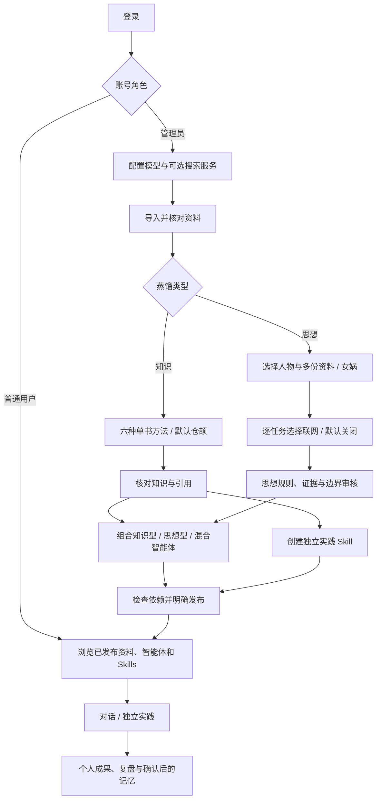

# 账号、双蒸馏与独立实践

2026-10-30 的本轮范围以本文及 `tasks/plan.md` 为准。仍是本地 Vue 3 + SQLite + 业务 API / Worker / 独立 AI 服务，不增加部署进程。

## 登录与分工

首次启动生成 `admin`、`user` 两个账号和随机密码，保存在 `data/local-accounts.json`（自定义数据目录时跟随该目录）。文件权限 0600，已由 `data/` 的 Git 忽略规则保护；重启不重置。密码哈希和 Session 在业务库的专用表中，不进入资产包。会话默认七天有效，使用 HttpOnly、SameSite=Lax Cookie；退出后服务端撤销 Session。浏览器跨域访问只允许本机已配置的前端/API 端口，不向任意 localhost 端口开放账号数据。

- 管理员默认进入 `/admin`，配置模型和搜索服务、管理资料、双蒸馏、审核和发布。可切换到前台使用自己的个人内容。
- 普通用户默认进入 `/`，只能阅读和使用已发布资产；不上传、蒸馏、创建公共资产或选择模型。
- 对话、消息、成果、实践、长期记忆和任务携带账号归属。个人内容通过列表、ID、搜索、统计、导出、事件流及 Worker 执行保持隔离。管理员任务中心可维护任务；完整工作区备份与来源清理是明确的全局管理操作。
- 普通用户的记忆确认只作用于自己的账号，不会因为选择了相同人物而与其他账号共享。

## 发布与版本

后台“当前结果”“启用”和“发布”是不同操作。发布管理位于 `/admin/publications`，支持查看确切版本、预检依赖、发布和下架。编辑后的草稿不会替换用户看到的发布版本；历史发布版本保留给旧会话的版本绑定，不提供未发布草稿的历史访问。

发布从依赖开始：资料、人物 → 知识结果／思想画像 → 智能体或实践 Skill → 关系。原文章节跟随所发布的资料版本；结果仅携带已核对的可用知识卡，候选和后台阶段报告不进入公共结果。知识卡也可单独发布。

发布知识卡的历史版本时，可在版本选择器中“核对原文”，再“确认此卡片版本已核对”。审核记录独立于不可变卡片内容；不会改写旧蒸馏结果。知识结果引用的资料版本可能早于当前资料版本；发布管理列出确切依赖版本，可明确发布该历史版本后再发布当前版本。

下架阻止新的使用，个人历史摘录保留。来源清理覆盖用户任务和依赖；删除原文件也清理公开快照中的原文，不能从历史发布缓存继续取回全文。删除资料及派生知识会清理相关公开快照并停用受影响资产。

## 两类蒸馏

### 知识

基础、Book to Skill、仓颉、三生、博览、Adler 仍按单份资料与所选章节运行。结果、知识卡版本、引用、当前结果和任务恢复规则沿用原实现。原历史结果属于知识蒸馏，不能因为方法包含“思想框架”就自动视作人物画像。

### 思想

在 `/admin/thoughts` 建立人物，再选择多份资料及章节运行女娲。也可从资料蒸馏弹窗选择“思想蒸馏”转入人物流程。画像独立于知识卡存在：

1. 对全部所选正文分块整理真实观察及原文证据。
2. 从著作、对话、表达、他者评价、决策、时间线六个维度分析；缺少材料的维度保留未知。
3. 提炼规则，检查跨场景复现、生成力、辨识度、矛盾和反例。
4. 保存独立思想画像和测试记录，逐条人工核对，再明确启用、发布。

每条规则包含类别、触发、行为、边界、归因、来源锚点、结构检查、模型评价和人工审核。无有效引用的规则不能确认；思想资产的更新不会重跑知识蒸馏。思想型 Agent 无需知识卡即可使用已确认规则和其原始证据；所有人物视角均为 AI 模拟，不是人物本人意见。

女娲适配采用固定上游提交和 MIT 声明，见 `docs/third-party/distillation-sources.json`。本地实现采用串行持久化阶段，不执行上游 Skill、脚本或通用工具环境；并非声称与上游完整运行环境等价。

## 可选联网

管理员在模型配置中维护 Tavily 搜索服务。密钥由独立 AI 服务加密保存，不返回普通前端，也不进入导出。

每次打开女娲新任务，联网默认为关闭；开启后才会调用搜索和网页正文提取。关闭时没有搜索或采集调用。联网采集最多六次搜索、每次五条、去重后最多二十页正文，单页超过十万字符会列入失败清单，不静默截断。总分析字符继续受系统任务限制控制。

网页先入资料库，保存 URL、采集时间、内容哈希和版本，再提炼规则。搜索摘要不作为原文；抓取失败和正文为空不构造引用。成功的请求和资料会复用，部分失败后可明确重试或在结果中选择“基于已采集资料继续”。状态不明的请求不会自动重发。无搜索凭据时，在提交前阻止开启联网的任务。

## Skills 独立运行

实践 Skill 的生成与引导分别使用管理员配置的 `skill_generate`、`skill_guidance` 用途；未单独分配时继承平台默认生成模型。Skill 不保存新的 `agent_id`，实践不加载人物画像、人物配置或人物模型。

旧实践保存完成步骤、历史快照和迁移说明，后续使用通用引导。导入旧资产包时同样去掉人物绑定。知识卡和来源仍是 Skill 的依赖；人物的编辑、归档和删除不影响独立实践。

## 迁移、恢复与验证

账号迁移可重复执行，旧个人内容归管理员、旧公共资产不自动发布。迁移前的运行任务转为中断待恢复；旧人物关联的 Skill 任务需要重新提交后续步骤。新增表包括账号、Session、迁移标记、逐版本人工审核、当前发布与历史发布快照。

完整资产包支持人物、思想画像、发布记录及其版本依赖，但恢复不会自动发布；发布记录作为核对材料。模型、搜索凭据、账号密码和 Session 不迁移；个人记录归导入账号，活动记忆重新确认。普通用户只能导出自己的对话、成果和实践记录。

自动测试使用临时数据库和模型替身；真实模型脚本为 `scripts/validate_dual_distillation.py`、`scripts/validate_dual_runtime.py`，仅使用原创虚构验收资料，明确产生已配置供应商用量。真实联网验证必须另有可用搜索凭据，不能以替身结果替代。
